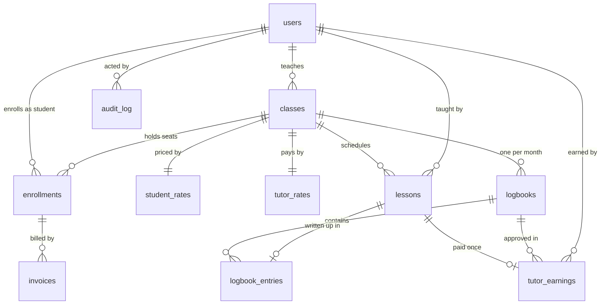

# Architecture

## How a request flows

```
Browser → proxy.ts → Server Component or Server Action → Supabase (as the signed-in user)
```

The browser never talks to Supabase directly. The session lives in an HttpOnly cookie, and the app uses only the public key, so every query runs as the signed-in user. Pages read through row level security (RLS), and every change goes through a Postgres function (RPC).

## Data model



- Rates are separate tables because RLS works per row, not per column. Tutors simply have no policy on `student_rates`.
- Invoices copy the hours and rate, and earnings copy the duration and rate, so later changes never rewrite history.
- `student_hours_balance` and `class_margin` are views, so hours left and margin are always calculated, never stored.

## Where business rules are enforced, and why

| Layer | Responsible for | Why here |
|---|---|---|
| Constraints | Values that must always be valid: uniqueness, no overlaps, text limits | Holds for every caller, including under concurrency |
| RLS and grants | Who can read what. API clients have `SELECT` only | Protects the API itself, not just the screens |
| RPCs | Every change: role check, rule, audit row, in one transaction. Row locks settle simultaneous requests | One place for each rule, and a change either fully happens or not at all |
| Triggers | Data that must never change, and whether a logbook entry is valid | Applies even to trusted code |
| `proxy.ts`, `requireRole()` | Refreshing the session, and sending people to the right pages. Each Server Action checks the role again | Good behaviour for users, backed by the layers above |
| UI | Showing data and helpful limits | Never trusted |

| Rule from the brief | Enforced by |
|---|---|
| No duplicate enrollment | Partial unique index `uniq_enrollments_open` |
| No exceeding capacity | Row lock on the class in `enroll_student()`, and trigger `enforce_class_capacity` |
| End follows start, no overlap for a tutor | `valid_time_range` check and an exclusion constraint on `lessons` |
| One logbook per class per month | `UNIQUE (class_id, month)` |
| One entry per lesson that has ended | `UNIQUE (lesson_id)` and trigger `logbook_entry_validation` |
| Only admins approve, approved is read-only | `approve_logbook()` and trigger `logbook_immutability` |
| Students see only paid classes, tutors only assigned ones | RLS using `is_paid_student_of_class()` and `is_tutor_of_class()` |
| Logbooks hidden from students until approved | RLS on `logbooks` and `logbook_entries` |
| Earnings once per lesson, approving again adds nothing | `UNIQUE (lesson_id)` on `tutor_earnings` and a status check |
| Earnings visible to the admin and that tutor only | RLS on `tutor_earnings`, and `preview_logbook_earnings()` returns only the caller's lessons |
| Tutors never see student rates | No tutor policy on `student_rates`, and `get_class_catalog()` refuses tutors |
| Payment is simulated | `mark_invoice_paid()`, admin only |

Sign in and sign out do a full page load. Next.js keeps recently visited pages hidden in the browser, and this clears them so the next person on a shared computer cannot find the previous account's data.

## Design system

- **Tokens:** `app/globals.css` defines the Star Generation colours (navy, gold, surface, cloud, muted, success, danger) and the 6px card radius as Tailwind theme values. DM Sans is loaded in `app/layout.tsx`.
- **Basics:** `components/ui.tsx` holds Button, Field, Input, Select, Textarea, Card, Alert, Table, Disclosure, PageHeader and StatusBadge.
- **Shared pieces:** `AppShell` (sidebar per role), `ActionForm` (pending state and error message for every action), `LessonTable` and `LogbookEntryFields`.
- **Rules:** components use token names, never raw colours. Status colours appear as a dot, border or tint with navy text, because green and red are hard to read as small text.
